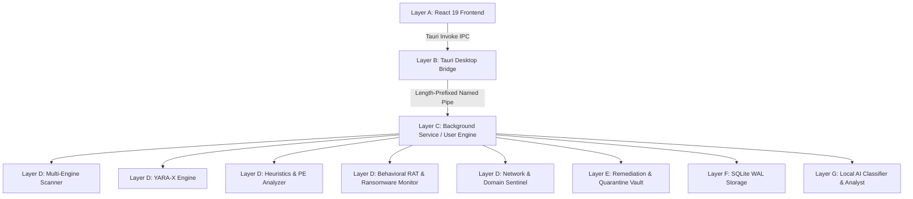

# AEGIS AI Security - Architecture Specification

## 1. System Philosophy & Multi-Layer Design

AEGIS AI Security is architected around the principle of strict privilege separation, local execution, and defensive robustness. Unprivileged components (such as the React webview) are physically isolated from privileged operating system operations.



---

## 2. Architectural Layers

### Layer A: Frontend (React 19 + TypeScript + Tailwind CSS v4)
- **Role**: Presentation and interaction layer running inside Microsoft Edge WebView2.
- **Constraints**: Absolutely no direct privileged Windows API access, file system tampering, or direct execution from the webview context. All actions flow through strongly typed Tauri commands.
- **State Management**: Zustand lightweight store for instantaneous UI responsiveness, bilingual (TR/EN) locale selection, theme switching (dark/light), and live status mirroring.

### Layer B: Tauri Desktop Bridge (`apps/desktop/src-tauri`)
- **Role**: Secure bridge connecting the React interface to the local security engine.
- **Commands**:
  - `aegis_call`: Validates, serializes, and dispatches IPC requests to the active security pipe.
  - `aegis_connection`: Queries service connectivity, pipe mode (`service` vs `user`), and security version.
  - `aegis_start_user_engine`: Spawns the local user engine when the Windows background service is not installed.
  - `aegis_open_path`: Opens paths in Windows Explorer via validated shell execution.

### Layer C: Security Service (`crates/aegis-service`)
- **Role**: Background supervisor responsible for scheduled scanning, real-time filesystem watchers, network socket monitoring, and persistence defense.
- **Modes**:
  1. **Windows Background Service (`--service`)**: Runs as a registered Windows Service under `NT AUTHORITY\SYSTEM` or a dedicated service account.
  2. **User Mode (`--run-user`)**: Runs within the user's unprivileged desktop session, hosting an isolated named pipe for per-user protection.
  3. **Management (`--install`, `--uninstall`)**: Registers or removes the Windows Service via the Windows Service Control Manager (SCM).

### Layer D: Detection Engine
- **`aegis-yara`**: Compiles and executes YARA-X rules (`rules/yara/*.yar`) against target files and memory buffers.
- **`aegis-heuristics`**: Analyzes PE binaries (entropy, RWX executable-writable sections, suspicious imports like `VirtualAllocEx`/`WriteProcessMemory`/`CreateRemoteThread`, double extensions, Authenticode signatures, and local reputation hashes).
- **`aegis-behavior`**:
  - **`RatHunter`**: Evaluates process creation chains (Office or browsers spawning `cmd.exe`, `powershell.exe`, or `certutil.exe`) and LOLBins.
  - **`RansomwareShield`**: Tracks 5-second sliding windows of file modification/rename bursts; flags rapid bulk extensions (`.locked`, `.crypto`, `.enc`) and ransom note names (`readme_decrypt.txt`).
- **`aegis-network`**: Maps active TCP/UDP sockets to process IDs (`GetExtendedTcpTable`), queries local domain reputation blocklists, and enforces Windows Firewall block rules.
- **`aegis-audit`**: Checks Windows Defender, Firewall, and UAC states; audits registry `Run`/`RunOnce` and Startup persistence; scans removable USB media (`DRIVE_REMOVABLE`).

### Layer E: Remediation Engine (`crates/aegis-remediation`, `crates/aegis-quarantine`)
- **Quarantine Vault**: Neutralizes threats by encrypting files with a random 32-byte XOR mask. Computes pre-quarantine and post-quarantine SHA-256 hashes to guarantee data integrity.
- **System Safeguards**: Protects critical Windows files (`Windows\System32`, `explorer.exe`, etc.) from accidental quarantine or termination.
- **Process Suspension**: Safely suspends threads of suspicious non-critical processes via `OpenThread`/`SuspendThread` while awaiting user remediation authorization.

### Layer F: Storage Engine (`crates/aegis-storage`)
- **Database**: SQLite in Write-Ahead Logging (WAL) mode with `NORMAL` synchronous pragma.
- **Tables**: `schema_migrations`, `scan_jobs`, `scan_cache`, `threat_records`, `quarantine_records`, `security_events`, `settings`, `audit_logs`.
- **Resilience**: Auto-detects corrupt database files, moves the corrupt database to a `.corrupt.<timestamp>.bak` file, and initializes a clean schema with zero crash loops.

### Layer G: Local AI Classifier & Analyst (`crates/aegis-ai`)
- **Classifier**: Extracts PE structural features (section count, imports, entropy, certificate presence) for ONNX Runtime evaluation. Transparently reports `"AI sınıflandırma modeli henüz kurulmadı."` when weights are absent.
- **Analyst**: Grounded deterministic security assistant citing exact forensic indicators (`SourceRef`), with optional integration to a local Ollama instance (`localhost:11434`). Never calls external cloud APIs.

---

## 3. IPC Protocol & Framing

Communication between the desktop bridge and the security engine utilizes Windows Named Pipes:
- **System Pipe**: `\\.\pipe\aegis-ai-security.v1`
- **User Pipe**: `\\.\pipe\aegis-user-<SID>`

### Wire Protocol:
Each message is framed with a 4-byte little-endian unsigned integer representing the byte length of the UTF-8 JSON payload:
```
+--------------------------+-------------------------------------+
| 4-byte LE Payload Length | UTF-8 JSON Request / Response       |
+--------------------------+-------------------------------------+
```

### Request Envelope:
```json
{
  "id": "req-uuid-v4",
  "command": "start_scan",
  "payload": {
    "scan_type": "quick",
    "custom_paths": null
  }
}
```

### Response Envelope:
```json
{
  "id": "req-uuid-v4",
  "success": true,
  "data": { "job_id": "job-uuid-v4" },
  "error": null
}
```

---

## 4. Concurrency & Performance Guarantees

- **Non-blocking Scanning**: Scans run on background worker threads (`tokio::task::spawn_blocking`), communicating progress via atomic variables and broadcast channels.
- **Archive Protection**: ZIP and compressed archives are checked against decompression bombs (max 200MB decompressed size, max 5,000 files, max 5 levels of nesting).
- **Graceful Cancellation**: Scan engines periodically inspect an atomic cancellation token, cleanly terminating jobs and recording partial metrics.

